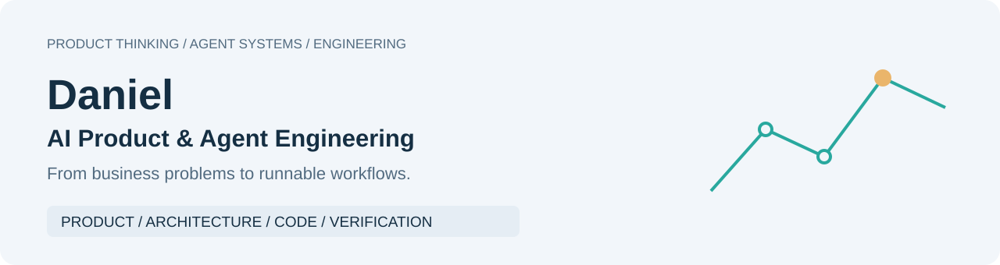

<strong>Language / 语言:</strong> <a href="https://github.com/Daniel-24-life">中文</a> · <strong>English</strong>

<picture>
  <source media="(prefers-color-scheme: dark)" srcset="assets/cover-en-dark.svg" />
  
</picture>

# Daniel · AI Product & Agent Engineering

[Full portfolio in English](https://github.com/Daniel-24-life/AIfile/blob/main/README.en.md) · [Code references](https://github.com/Daniel-24-life/AIfile/tree/main/shelves/code)

I build AI product prototypes and agent workflows around business needs, with
explicit tool boundaries, evidence records and human review.

**🔥 Recent Focus:**
- **[Trade Desk Copilot](https://github.com/Daniel-24-life/trade-desk-copilot/blob/main/README.en.md)**: Edge-docked HUD desktop workbench featuring session isolation, host-aware clipboard cleaning, hybrid retrieval (BM25 + Semantic), and automated 1080x1080 quotation cards for global trade reps.
- **[Localization Integrity Lab](https://github.com/Daniel-24-life/localization-integrity-lab/blob/main/README.en.md)**: A reproducible research benchmark spanning kinematic ODE dynamics, error Gramian observability, absorbing boundary PDE hazard probabilities, and colored-noise Kalman filtering.

Explore each project through its product, architecture, code and verification.

**Choose a path:** [Trade Desk Copilot](https://github.com/Daniel-24-life/trade-desk-copilot/blob/main/README.en.md) · [Localization Integrity Lab](https://github.com/Daniel-24-life/localization-integrity-lab/blob/main/README.en.md) · [CosmoPilot V4](https://github.com/Daniel-24-life/cosmopilot-v4/blob/main/README.en.md) · [Logistics Workflow](https://github.com/Daniel-24-life/logistics-workbench/blob/main/README.en.md) · [Buyer Research](https://github.com/Daniel-24-life/buyer-research-agent/blob/main/README.en.md) · [Agent Governance](https://github.com/Daniel-24-life/btc-agent-governance/blob/main/README.en.md)

<!-- portfolio:start -->

## Selected work

### [CosmoPilot V4.0](https://github.com/Daniel-24-life/cosmopilot-v4/blob/main/README.en.md)

Consumer-service evidence, protected drafts and local feedback in one workspace.

**Offline public reference of V4.0 mechanisms** · <a href="https://github.com/Daniel-24-life/cosmopilot-v4/blob/main/README.en.md">Run / overview</a> · <a href="https://github.com/Daniel-24-life/cosmopilot-v4/blob/main/docs/architecture.md">Architecture (Chinese)</a> · <a href="https://github.com/Daniel-24-life/cosmopilot-v4/blob/main/docs/source-reading.md">Source guide (Chinese)</a> · <a href="https://github.com/Daniel-24-life/cosmopilot-v4/blob/main/docs/VERIFICATION.md">Verification (Chinese)</a>

---

### [Trade Desk Copilot](https://github.com/Daniel-24-life/trade-desk-copilot/blob/main/README.en.md)

Edge-docked HUD workbench: session isolation, interactive DST slot tracking, RAG catalog grounding, and 1080x1080 quotation cards.

**Offline product demo** · <a href="https://github.com/Daniel-24-life/trade-desk-copilot/blob/main/README.en.md">Run / overview</a> · <a href="https://github.com/Daniel-24-life/trade-desk-copilot/blob/main/assets/screenshots/architecture_overview.svg">Architecture (Chinese)</a> · <a href="https://github.com/Daniel-24-life/trade-desk-copilot/blob/main/core/agent.py">Source</a> · <a href="https://github.com/Daniel-24-life/trade-desk-copilot/blob/main/README.md">Verification (Chinese)</a>

---

### [Localization Integrity Lab](https://github.com/Daniel-24-life/localization-integrity-lab/blob/main/README.en.md)

Kinematic ODEs, Gramian observability, absorbing boundary PDEs, and colored-noise filtering.

**Reproducible research benchmark** · <a href="https://github.com/Daniel-24-life/localization-integrity-lab/blob/main/README.en.md">Run / overview</a> · <a href="https://github.com/Daniel-24-life/localization-integrity-lab/blob/main/assets/screenshots/research_overview.svg">Architecture (Chinese)</a> · <a href="https://github.com/Daniel-24-life/localization-integrity-lab/blob/main/scripts/run_synthetic_study.py">Source</a> · <a href="https://github.com/Daniel-24-life/localization-integrity-lab/blob/main/docs/mathematical_formulation.md">Verification (Chinese)</a>

---

### [Hangxu Logistics Workbench](https://github.com/Daniel-24-life/logistics-workbench/blob/main/README.en.md)

A synthetic exception-to-task workflow with role views.

**Offline product demo** · <a href="https://github.com/Daniel-24-life/logistics-workbench/blob/main/README.en.md">Run / overview</a> · <a href="https://github.com/Daniel-24-life/logistics-workbench/blob/main/docs/architecture.md">Architecture (Chinese)</a> · <a href="https://github.com/Daniel-24-life/logistics-workbench/tree/main/dist">Source</a> · <a href="https://github.com/Daniel-24-life/logistics-workbench/blob/main/docs/VERIFICATION.md">Verification (Chinese)</a>

---

### [Buyer Research Agent](https://github.com/Daniel-24-life/buyer-research-agent/blob/main/README.en.md)

Demand evidence, unknowns and a durable local queue.

**Offline reference** · <a href="https://github.com/Daniel-24-life/buyer-research-agent/blob/main/README.en.md">Run / overview</a> · <a href="https://github.com/Daniel-24-life/buyer-research-agent/blob/main/docs/architecture.md">Architecture (Chinese)</a> · <a href="https://github.com/Daniel-24-life/buyer-research-agent/blob/main/core.py">Source</a> · <a href="https://github.com/Daniel-24-life/buyer-research-agent/blob/main/docs/VERIFICATION.md">Verification (Chinese)</a>

---

### [BTC Agent Governance](https://github.com/Daniel-24-life/btc-agent-governance/blob/main/README.en.md)

Four synthetic scenarios with bounded evidence and no trading authority.

**Research governance skeleton** · <a href="https://github.com/Daniel-24-life/btc-agent-governance/blob/main/README.en.md">Run / overview</a> · <a href="https://github.com/Daniel-24-life/btc-agent-governance/blob/main/docs/architecture.md">Architecture (Chinese)</a> · <a href="https://github.com/Daniel-24-life/btc-agent-governance/blob/main/public_demo.py">Source</a> · <a href="https://github.com/Daniel-24-life/btc-agent-governance/blob/main/docs/VERIFICATION.md">Verification (Chinese)</a>

## Read deeper

[All projects](https://github.com/Daniel-24-life/AIfile/blob/main/README.en.md) · [Code references](https://github.com/Daniel-24-life/AIfile/tree/main/shelves/code) · [Learning and methods](https://github.com/Daniel-24-life/AIfile/tree/main/shelves/understanding)

## Recent releases

- 2026-11-04 · [Trade Desk Copilot](https://github.com/Daniel-24-life/trade-desk-copilot/blob/main/README.en.md) · v1.0 — Initial open-source release: dual-mode offline simulation, interactive DST state machine, and host-aware formatting.
- 2026-11-04 · [Localization Integrity Lab](https://github.com/Daniel-24-life/localization-integrity-lab/blob/main/README.en.md) · v1.0 — Initial research release: 144-condition benchmark, absorbing boundary PDE solvers, and 116 tests.
- 2026-10-25 · [CosmoPilot V4.0](https://github.com/Daniel-24-life/cosmopilot-v4/blob/main/README.en.md) · V4.0 public reference — Consumer-service workspace, AI Coding notes and synthetic reference demo.

## Add the next project

[Publishing guide and templates (Chinese)](https://github.com/Daniel-24-life/AIfile/blob/main/docs/ADD_PROJECT.md)

<!-- portfolio:end -->

---

Public demos use synthetic material; real records and production execution
chains remain private. Discuss technical questions through each project's Issues.

The English illustrations explain system structure, not translated application
interfaces. Deep technical documents marked “Chinese” retain their original language.
