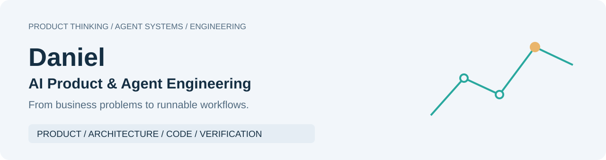

<strong>Language / 语言:</strong> <a href="https://github.com/Daniel-24-life">中文</a> · <strong>English</strong>

<picture>
  <source media="(prefers-color-scheme: dark)" srcset="assets/cover-en-dark.svg" />
  
</picture>

# Daniel · AI Product & Agent Engineering

[Full portfolio in English](https://github.com/Daniel-24-life/AIfile/blob/main/README.en.md) · [Code references](https://github.com/Daniel-24-life/AIfile/tree/main/shelves/code)

I build AI product prototypes and agent workflows around business needs, with
explicit tool boundaries, evidence records and human review.

Explore each project through its product, architecture, code and verification.

**Choose a path:** [AI Coding & consumer service](https://github.com/Daniel-24-life/cosmopilot-v4/blob/main/README.en.md) · [Logistics workflow](https://github.com/Daniel-24-life/logistics-workbench/blob/main/README.en.md) · [Buyer research](https://github.com/Daniel-24-life/buyer-research-agent/blob/main/README.en.md) · [Agent governance](https://github.com/Daniel-24-life/btc-agent-governance/blob/main/README.en.md) · [Engineering case study](https://github.com/Daniel-24-life/agentplatform-case-study/blob/main/README.en.md)

<!-- portfolio:start -->

## Selected work

### [CosmoPilot V4.0](https://github.com/Daniel-24-life/cosmopilot-v4/blob/main/README.en.md)

Consumer-service evidence, protected drafts and local feedback in one workspace.

**Offline public reference of V4.0 mechanisms** · <a href="https://github.com/Daniel-24-life/cosmopilot-v4/blob/main/README.en.md">Run / overview</a> · <a href="https://github.com/Daniel-24-life/cosmopilot-v4/blob/main/docs/architecture.md">Architecture (Chinese)</a> · <a href="https://github.com/Daniel-24-life/cosmopilot-v4/blob/main/docs/source-reading.md">Source guide (Chinese)</a> · <a href="https://github.com/Daniel-24-life/cosmopilot-v4/blob/main/docs/VERIFICATION.md">Verification (Chinese)</a>

---

### [Hangxu Logistics Workbench](https://github.com/Daniel-24-life/logistics-workbench/blob/main/README.en.md)

A synthetic exception-to-task workflow with role views.

**Offline product demo** · <a href="https://github.com/Daniel-24-life/logistics-workbench/blob/main/README.en.md">Run / overview</a> · <a href="https://github.com/Daniel-24-life/logistics-workbench/blob/main/docs/architecture.md">Architecture (Chinese)</a> · <a href="https://github.com/Daniel-24-life/logistics-workbench/tree/main/dist">Source</a> · <a href="https://github.com/Daniel-24-life/logistics-workbench/blob/main/docs/VERIFICATION.md">Verification (Chinese)</a>

---

### [Buyer Research Agent](https://github.com/Daniel-24-life/buyer-research-agent/blob/main/README.en.md)

Demand evidence, unknowns and a durable local queue.

**Offline reference** · <a href="https://github.com/Daniel-24-life/buyer-research-agent/blob/main/README.en.md">Run / overview</a> · <a href="https://github.com/Daniel-24-life/buyer-research-agent/blob/main/docs/architecture.md">Architecture (Chinese)</a> · <a href="https://github.com/Daniel-24-life/buyer-research-agent/blob/main/core.py">Source</a> · <a href="https://github.com/Daniel-24-life/buyer-research-agent/blob/main/docs/VERIFICATION.md">Verification (Chinese)</a>

---

### [BTC Agent Governance](https://github.com/Daniel-24-life/btc-agent-governance/blob/main/README.en.md)

Four synthetic scenarios with bounded evidence and no trading authority.

**Research governance skeleton** · <a href="https://github.com/Daniel-24-life/btc-agent-governance/blob/main/README.en.md">Run / overview</a> · <a href="https://github.com/Daniel-24-life/btc-agent-governance/blob/main/docs/architecture.md">Architecture (Chinese)</a> · <a href="https://github.com/Daniel-24-life/btc-agent-governance/blob/main/public_demo.py">Source</a> · <a href="https://github.com/Daniel-24-life/btc-agent-governance/blob/main/docs/VERIFICATION.md">Verification (Chinese)</a>

---

### [AgentPlatform Case Study](https://github.com/Daniel-24-life/agentplatform-case-study/blob/main/README.en.md)

Controlled single-task execution and lessons from a discontinued product.

**Discontinued** · <a href="https://github.com/Daniel-24-life/agentplatform-case-study/blob/main/README.en.md">Run / overview</a> · <a href="https://github.com/Daniel-24-life/agentplatform-case-study/blob/main/docs/ARCHIVE_ARCHITECTURE.md">Architecture (Chinese)</a> · <a href="https://github.com/Daniel-24-life/agentplatform-case-study/blob/main/docs/SOURCE_READING_GUIDE.md">Source guide (Chinese)</a> · <a href="https://github.com/Daniel-24-life/agentplatform-case-study/blob/main/docs/VERIFICATION_RECORD.md">Verification (Chinese)</a>

## Read deeper

[All projects](https://github.com/Daniel-24-life/AIfile/blob/main/README.en.md) · [Code references](https://github.com/Daniel-24-life/AIfile/tree/main/shelves/code) · [Learning and methods](https://github.com/Daniel-24-life/AIfile/tree/main/shelves/understanding)

## Recent releases

- 2026-10-25 · [CosmoPilot V4.0](https://github.com/Daniel-24-life/cosmopilot-v4/blob/main/README.en.md) · V4.0 public reference — Consumer-service workspace, AI Coding notes and synthetic reference demo.
- 2026-10-15 · [Hangxu Logistics Workbench](https://github.com/Daniel-24-life/logistics-workbench/blob/main/README.en.md) · v1.1 — Queue-first review workbench redesign.
- 2026-10-15 · [Buyer Research Agent](https://github.com/Daniel-24-life/buyer-research-agent/blob/main/README.en.md) · v1.1 — Evidence-first workspace and explicit connection states.

## Add the next project

[Publishing guide and templates (Chinese)](https://github.com/Daniel-24-life/AIfile/blob/main/docs/ADD_PROJECT.md)

<!-- portfolio:end -->

---

Public demos use synthetic material; real records and production execution
chains remain private. Discuss technical questions through each project's Issues.

The English illustrations explain system structure, not translated application
interfaces. Deep technical documents marked “Chinese” retain their original language.
