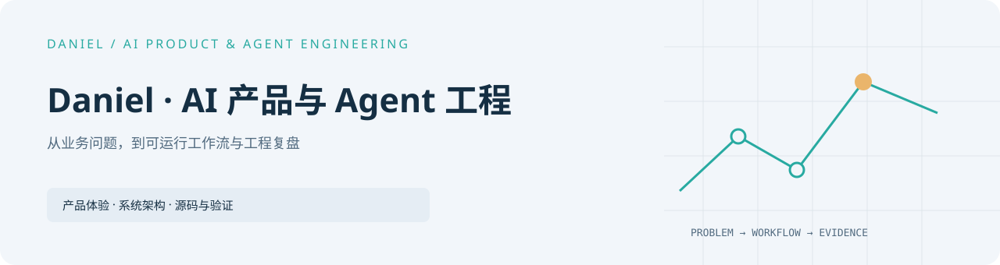

<picture>
  <source media="(prefers-color-scheme: dark)" srcset="assets/cover-dark.svg" />
  
</picture>

# I turn business problems into runnable, inspectable AI workflows

[中文](README.md) · [Full portfolio](https://github.com/Daniel-24-life/AIfile) · [Runnable code](https://github.com/Daniel-24-life/AIfile/tree/main/shelves/code)

I'm Daniel, focused on AI products and agent engineering. My work starts with
problem models, then moves through tool and permission boundaries, evidence
records, human review, and a runnable product experience.

The selected projects below follow the same path: experience → architecture → source
→ verification. Each one states what is implemented and where its limits are.

**Choose a path:** [AI Coding and consumer service](https://github.com/Daniel-24-life/cosmopilot-v4) · [Product workbench](https://github.com/Daniel-24-life/logistics-workbench) · [Research agent](https://github.com/Daniel-24-life/buyer-research-agent) · [Governance design](https://github.com/Daniel-24-life/btc-agent-governance) · [Engineering retrospective](https://github.com/Daniel-24-life/agentplatform-case-study)

<!-- portfolio:start -->

## Selected work

### [CosmoPilot V4.0](https://github.com/Daniel-24-life/cosmopilot-v4)

Consumer-service evidence, protected drafts and local feedback in one workspace.

**Offline public reference of V4.0 mechanisms** · <a href="https://github.com/Daniel-24-life/cosmopilot-v4">Run / overview</a> · <a href="https://github.com/Daniel-24-life/cosmopilot-v4/blob/main/docs/architecture.md">Architecture</a> · <a href="https://github.com/Daniel-24-life/cosmopilot-v4/blob/main/docs/source-reading.md">Source</a> · <a href="https://github.com/Daniel-24-life/cosmopilot-v4/blob/main/docs/VERIFICATION.md">Verification</a>

---

### [Hangxu Logistics Workbench](https://github.com/Daniel-24-life/logistics-workbench)

A synthetic exception-to-task workflow with role views.

**Offline product demo** · <a href="https://github.com/Daniel-24-life/logistics-workbench">Run / overview</a> · <a href="https://github.com/Daniel-24-life/logistics-workbench/blob/main/docs/architecture.md">Architecture</a> · <a href="https://github.com/Daniel-24-life/logistics-workbench/tree/main/dist">Source</a> · <a href="https://github.com/Daniel-24-life/logistics-workbench/blob/main/docs/VERIFICATION.md">Verification</a>

---

### [Buyer Research Agent](https://github.com/Daniel-24-life/buyer-research-agent)

Demand evidence, unknowns and a durable local queue.

**Offline reference** · <a href="https://github.com/Daniel-24-life/buyer-research-agent">Run / overview</a> · <a href="https://github.com/Daniel-24-life/buyer-research-agent/blob/main/docs/architecture.md">Architecture</a> · <a href="https://github.com/Daniel-24-life/buyer-research-agent/blob/main/core.py">Source</a> · <a href="https://github.com/Daniel-24-life/buyer-research-agent/blob/main/docs/VERIFICATION.md">Verification</a>

---

### [BTC Agent Governance](https://github.com/Daniel-24-life/btc-agent-governance)

Four synthetic scenarios with bounded evidence and no trading authority.

**Research governance skeleton** · <a href="https://github.com/Daniel-24-life/btc-agent-governance">Run / overview</a> · <a href="https://github.com/Daniel-24-life/btc-agent-governance/blob/main/docs/architecture.md">Architecture</a> · <a href="https://github.com/Daniel-24-life/btc-agent-governance/blob/main/public_demo.py">Source</a> · <a href="https://github.com/Daniel-24-life/btc-agent-governance/blob/main/docs/VERIFICATION.md">Verification</a>

---

### [AgentPlatform Case Study](https://github.com/Daniel-24-life/agentplatform-case-study)

Trusted single-task execution and an unfulfilled product experience.

**Discontinued** · <a href="https://github.com/Daniel-24-life/agentplatform-case-study">Run / overview</a> · <a href="https://github.com/Daniel-24-life/agentplatform-case-study/blob/main/docs/ARCHIVE_ARCHITECTURE.md">Architecture</a> · <a href="https://github.com/Daniel-24-life/agentplatform-case-study/blob/main/docs/SOURCE_READING_GUIDE.md">Source</a> · <a href="https://github.com/Daniel-24-life/agentplatform-case-study/blob/main/docs/VERIFICATION_RECORD.md">Verification</a>

## Read deeper

[All projects](https://github.com/Daniel-24-life/AIfile) · [Code references](https://github.com/Daniel-24-life/AIfile/tree/main/shelves/code) · [Learning and methods](https://github.com/Daniel-24-life/AIfile/tree/main/shelves/understanding)

## Recent releases

- 2026-10-25 · [CosmoPilot V4.0](https://github.com/Daniel-24-life/cosmopilot-v4) · V4.0 公开参考版 — Consumer-service workspace, AI Coding notes and synthetic reference demo.
- 2026-10-15 · [Hangxu Logistics Workbench](https://github.com/Daniel-24-life/logistics-workbench) · v1.1 — Queue-first review workbench redesign.
- 2026-10-15 · [Buyer Research Agent](https://github.com/Daniel-24-life/buyer-research-agent) · v1.1 — Evidence-first workspace and explicit connection states.

## Add the next project

[Publishing guide and templates](https://github.com/Daniel-24-life/AIfile/blob/main/docs/ADD_PROJECT.md)

<!-- portfolio:end -->

---

Public demos use synthetic material; real records and production execution
chains remain private. Discuss technical questions through each project's Issues.
