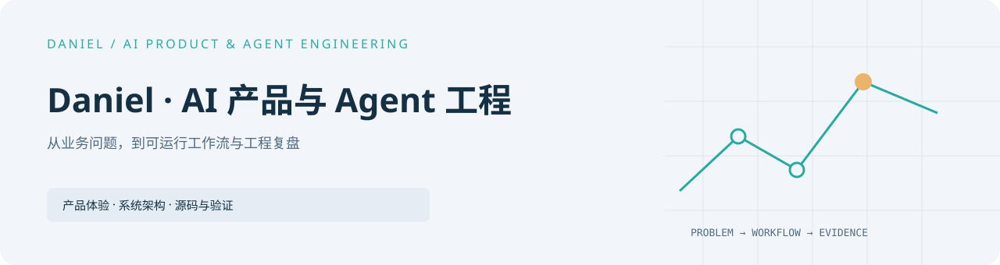

<strong>语言 / Language：</strong> <strong>中文</strong> · <a href="https://github.com/Daniel-24-life/Daniel-24-life/blob/main/README.en.md">English →</a>

<picture>
  <source media="(prefers-color-scheme: dark)" srcset="assets/cover-dark.svg" />
  
</picture>

# 把业务问题做成可运行、可检查的 AI 工作流

[English](README.en.md) · [完整作品集](https://github.com/Daniel-24-life/AIfile) · [可运行代码](https://github.com/Daniel-24-life/AIfile/tree/main/shelves/code)

我是 Daniel，专注 AI 产品与 Agent 工程。我的工作从问题建模开始，经过工具与权限边界、
证据记录和人工复核，最后落到可运行的产品体验。

**🔥 近期主线工作：**
- **[外贸桌面协作助手 (Trade Desk Copilot)](https://github.com/Daniel-24-life/trade-desk-copilot)**：贴边轻量悬浮 HUD、多会话隔离、剪贴板清洗、混合检索知识库与 1080×1080 离线报价卡生成，打造外贸业务人员开箱即用的桌面副驾驶。
- **[移动机器人定位完整性研究 (Localization Integrity Lab)](https://github.com/Daniel-24-life/localization-integrity-lab)**：基于运动学 ODE、误差可观测性 Gramian、吸收边界 PDE 越界概率量化及有色噪声滤波，构建严谨、全闭环的可复现科研基准。

下面的精选作品按“体验 → 架构 → 源码 → 验证”组织，并明确说明实现范围与限制。

**快速选择：** [外贸桌面助手](https://github.com/Daniel-24-life/trade-desk-copilot) · [定位完整性研究](https://github.com/Daniel-24-life/localization-integrity-lab) · [AI 消费者服务](https://github.com/Daniel-24-life/cosmopilot-v4) · [物流协同工作台](https://github.com/Daniel-24-life/logistics-workbench) · [买家研究 Agent](https://github.com/Daniel-24-life/buyer-research-agent) · [治理骨架](https://github.com/Daniel-24-life/btc-agent-governance)

<!-- portfolio:start -->

## 精选作品

### [知微 CosmoPilot · V4.0](https://github.com/Daniel-24-life/cosmopilot-v4)

把消费者进线、时点证据、人工草稿复核和本地反馈放进同一工作台。

**V4.0 机制的离线公开参考版** · <a href="https://github.com/Daniel-24-life/cosmopilot-v4">体验与运行</a> · <a href="https://github.com/Daniel-24-life/cosmopilot-v4/blob/main/docs/architecture.md">架构</a> · <a href="https://github.com/Daniel-24-life/cosmopilot-v4/blob/main/docs/source-reading.md">源码</a> · <a href="https://github.com/Daniel-24-life/cosmopilot-v4/blob/main/docs/VERIFICATION.md">验证</a>

---

### [外贸桌面协作助手](https://github.com/Daniel-24-life/trade-desk-copilot)

常驻桌面的 HUD 协作工作台：多买家会话隔离、交互式 DST 槽位追踪、RAG 商品目录与 1080 报价卡生成。

**离线产品演示** · <a href="https://github.com/Daniel-24-life/trade-desk-copilot">体验与运行</a> · <a href="https://github.com/Daniel-24-life/trade-desk-copilot/blob/main/assets/screenshots/architecture_overview.svg">架构</a> · <a href="https://github.com/Daniel-24-life/trade-desk-copilot/blob/main/core/agent.py">源码</a> · <a href="https://github.com/Daniel-24-life/trade-desk-copilot/blob/main/README.md">验证</a>

---

### [移动机器人定位完整性研究](https://github.com/Daniel-24-life/localization-integrity-lab)

动力学 ODE、误差可观测性 Gramian、吸收边界 PDE 越界概率与有色噪声滤波基准。

**可复现科研基准** · <a href="https://github.com/Daniel-24-life/localization-integrity-lab">体验与运行</a> · <a href="https://github.com/Daniel-24-life/localization-integrity-lab/blob/main/assets/screenshots/research_overview.svg">架构</a> · <a href="https://github.com/Daniel-24-life/localization-integrity-lab/blob/main/scripts/run_synthetic_study.py">源码</a> · <a href="https://github.com/Daniel-24-life/localization-integrity-lab/blob/main/docs/mathematical_formulation.md">验证</a>

---

### [航序 · 物流协同工作台](https://github.com/Daniel-24-life/logistics-workbench)

把物流异常、人工审核、角色动作和调度任务组织成可体验的闭环。

**离线产品演示** · <a href="https://github.com/Daniel-24-life/logistics-workbench">体验与运行</a> · <a href="https://github.com/Daniel-24-life/logistics-workbench/blob/main/docs/architecture.md">架构</a> · <a href="https://github.com/Daniel-24-life/logistics-workbench/tree/main/dist">源码</a> · <a href="https://github.com/Daniel-24-life/logistics-workbench/blob/main/docs/VERIFICATION.md">验证</a>

---

### [外贸买家研究 Agent](https://github.com/Daniel-24-life/buyer-research-agent)

用需求原文、日期和核验缺口区分明确需求、采购机会与待核验线索。

**离线参考实现** · <a href="https://github.com/Daniel-24-life/buyer-research-agent">体验与运行</a> · <a href="https://github.com/Daniel-24-life/buyer-research-agent/blob/main/docs/architecture.md">架构</a> · <a href="https://github.com/Daniel-24-life/buyer-research-agent/blob/main/core.py">源码</a> · <a href="https://github.com/Daniel-24-life/buyer-research-agent/blob/main/docs/VERIFICATION.md">验证</a>

---

### [BTC Agent 治理](https://github.com/Daniel-24-life/btc-agent-governance)

分开判断任务路由、证据声明与状态晋级，四种合成场景始终没有执行权限。

**研究治理骨架** · <a href="https://github.com/Daniel-24-life/btc-agent-governance">体验与运行</a> · <a href="https://github.com/Daniel-24-life/btc-agent-governance/blob/main/docs/architecture.md">架构</a> · <a href="https://github.com/Daniel-24-life/btc-agent-governance/blob/main/public_demo.py">源码</a> · <a href="https://github.com/Daniel-24-life/btc-agent-governance/blob/main/docs/VERIFICATION.md">验证</a>

## 深入阅读

[全部项目与分类](https://github.com/Daniel-24-life/AIfile) · [代码参考](https://github.com/Daniel-24-life/AIfile/tree/main/shelves/code) · [方法与学习](https://github.com/Daniel-24-life/AIfile/tree/main/shelves/understanding)

## 近期更新

- 2026-11-04 · [外贸桌面协作助手](https://github.com/Daniel-24-life/trade-desk-copilot) · v1.0 — 全新开源发布：双模离线仿真、交互式 DST 状态机与宿主格式清洗。
- 2026-11-04 · [移动机器人定位完整性研究](https://github.com/Daniel-24-life/localization-integrity-lab) · v1.0 — 独立科研开源：144 条件合成基准、吸收边界 PDE 求解器与 116 项物理单元测试。
- 2026-10-25 · [知微 CosmoPilot · V4.0](https://github.com/Daniel-24-life/cosmopilot-v4) · V4.0 公开参考版 — 新增消费者服务工作台、AI Coding 说明与合成参考演示。

## 添加下一项作品

[维护指南与项目模板](https://github.com/Daniel-24-life/AIfile/blob/main/docs/ADD_PROJECT.md)

<!-- portfolio:end -->

---

公开演示均使用合成材料；真实资料与生产执行链保持私有。技术问题可在对应项目的
Issues 中讨论。
