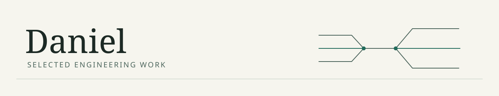
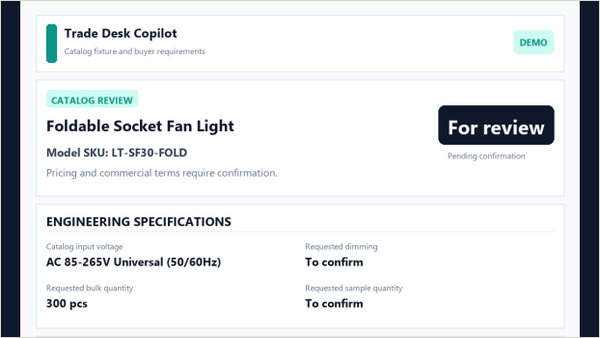
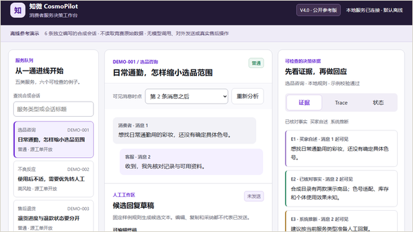
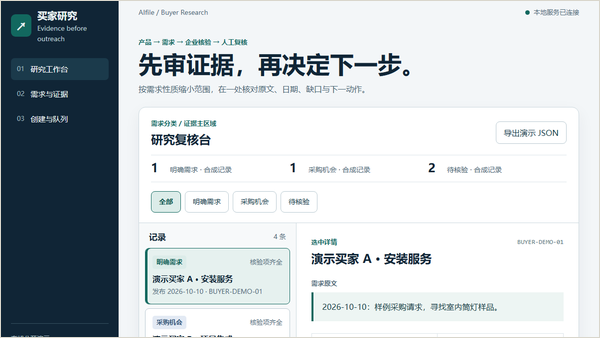

<picture>
  <source media="(prefers-color-scheme: dark)" srcset="assets/header-dark.svg" />
  <source media="(prefers-color-scheme: light)" srcset="assets/header-light.svg" />
  
</picture>

**I build AI agents that know when to stop and ask a human.**

Evidence retrieval, dialogue state, and review gates — shipped as desktop and web workbenches.

**[Explore the project gallery](https://daniel-24-life.github.io/portfolio/)** · [中文](README.zh.md) · [Repository index](https://github.com/Daniel-24-life/portfolio)

12 public repositories · 225 automated tests · 4 live project demos

## Featured projects

<table>
<tbody>
<tr>
<td width="50%" valign="top">
 
<strong>Trade Desk Copilot</strong> 
Correct inquiry fields, then review the matching catalog quote. 
<a href="https://github.com/Daniel-24-life/trade-desk-copilot#demo">Demo GIF</a> · <a href="https://github.com/Daniel-24-life/trade-desk-copilot">Repo</a>
</td>
<td width="50%" valign="top">
 
<strong>CosmoPilot V4.0</strong> 
Inspect evidence at a conversation cutoff and protect manual draft edits. 
<a href="https://github.com/Daniel-24-life/cosmopilot-v4#demo">Demo GIF</a> · <a href="https://github.com/Daniel-24-life/cosmopilot-v4">Repo</a>
</td>
</tr>
<tr>
<td width="50%" valign="top">
 
<strong>Buyer Research Agent</strong> 
Classify buyer demand and put evidence gaps into a review queue. 
<a href="https://github.com/Daniel-24-life/buyer-research-agent#demo">Demo GIF</a> · <a href="https://github.com/Daniel-24-life/buyer-research-agent">Repo</a>
</td>
<td width="50%" valign="top">
 
<strong>Logistics Workbench</strong> 
Route a shipment exception into a task and follow its status. 
<a href="https://daniel-24-life.github.io/logistics-workbench/">Live demo</a> · <a href="https://github.com/Daniel-24-life/logistics-workbench">Repo</a>
</td>
</tr>
</tbody>
</table>

## How I build agents

- **Evidence before answers.** Show what the decision relies on and surface missing evidence.
- **Bounded automation.** Route unclear or consequential cases to a human reviewer.
- **Reproducible by default.** Publish fixtures, commands, and the scope of each check.
