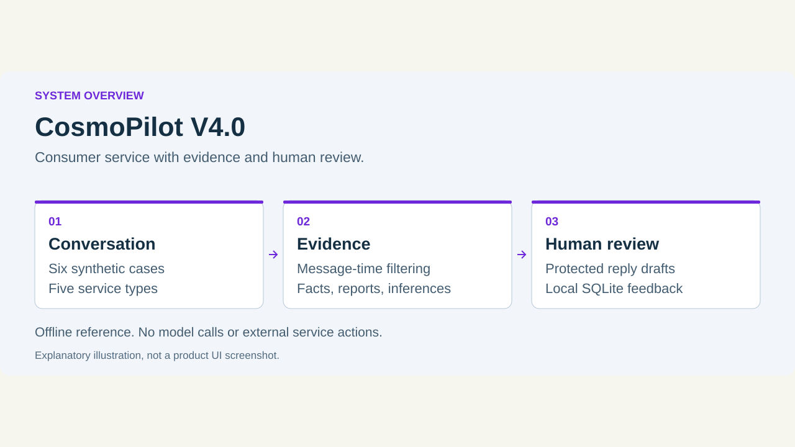
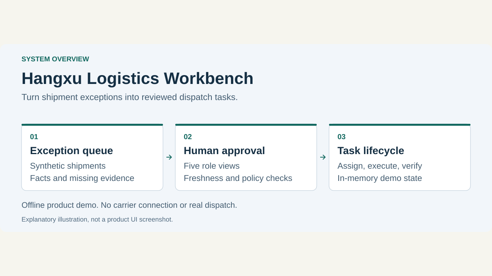
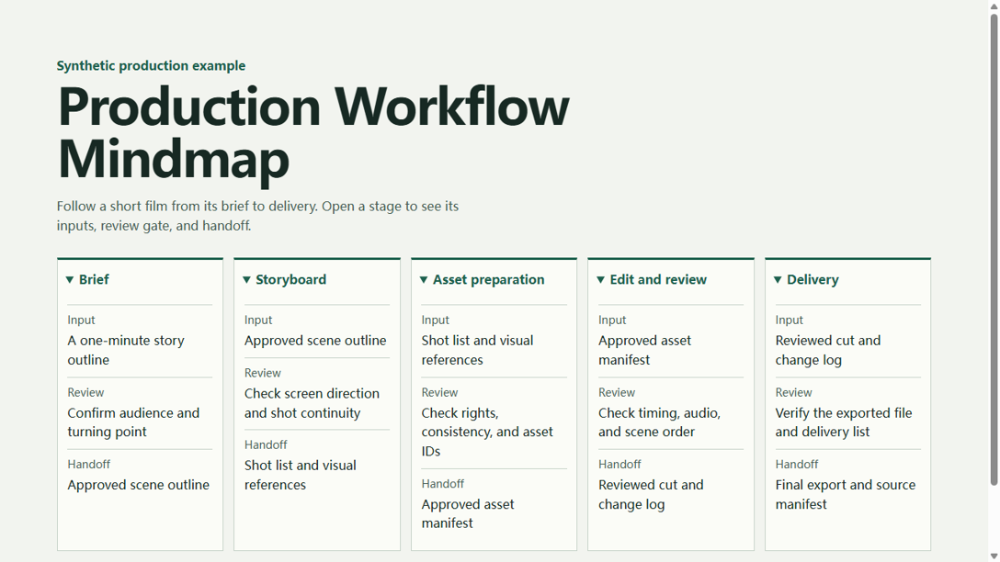
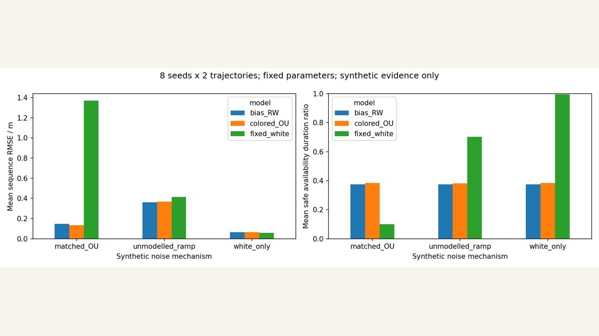
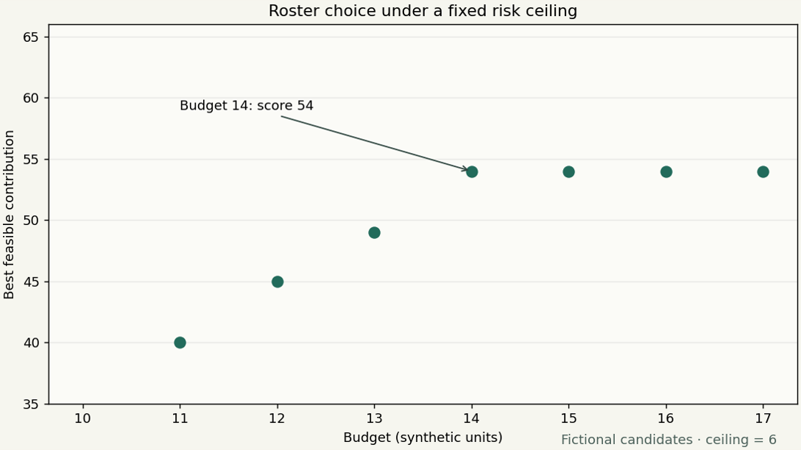
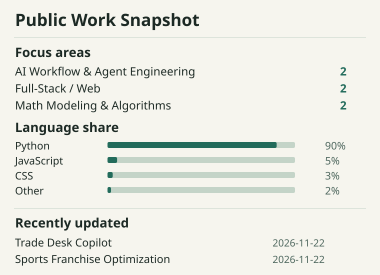

<picture>
  <source media="(prefers-color-scheme: dark)" srcset="assets/header-dark.svg">
  <source media="(prefers-color-scheme: light)" srcset="assets/header-light.svg">
  
</picture>

I build AI workflows and web products with clear review steps.
My modeling work makes assumptions and results reproducible.

[Full portfolio](https://github.com/Daniel-24-life/AIfile) · [中文](README.zh.md)

## Focus

| Area | What I work on |
| --- | --- |
| **AI Workflow & Agent Engineering** | Dialogue state, evidence retrieval, human review, and bounded automation. |
| **Full-Stack / Web** | Browser workbenches, responsive interfaces, and product workflows. |
| **Math Modeling & Algorithms** | Dynamical systems, integrity checks, and constrained optimization. |

## Featured Work

### [Trade Desk Copilot](https://github.com/Daniel-24-life/trade-desk-copilot)

A desktop assistant for reviewing a fictional B2B inquiry, its supporting evidence, and a quote draft.

**Stack** · Python · PyQt5 · Dialog state · Offline retrieval

### [CosmoPilot V4.0](https://github.com/Daniel-24-life/cosmopilot-v4)

A local consumer-service workbench that protects human draft edits and records review decisions.

**Stack** · Python · SQLite · HTML/CSS/JavaScript

### [Logistics Workbench](https://github.com/Daniel-24-life/logistics-workbench)

A browser workbench for taking a synthetic logistics exception through review, dispatch, and closure.

**Stack** · HTML/CSS · JavaScript · Node.js tests

### [Production Workflow Mindmap](https://github.com/Daniel-24-life/production-workflow-mindmap)

A responsive, keyboard-operable map of production handoffs and review gates.

**Stack** · Semantic HTML · CSS · Native disclosure

### [Localization Integrity Lab](https://github.com/Daniel-24-life/localization-integrity-lab)

A synthetic benchmark for positioning error, filter assumptions, and first exit under a specified stochastic model.

**Stack** · Python · ODE · EKF · Absorbing-boundary PDE

### [Sports Franchise Optimization](https://github.com/Daniel-24-life/sports-franchise-optimization)

A small, exact roster optimizer that makes budget, role, and risk constraints visible.

**Stack** · Python · Constrained enumeration · Matplotlib

## Public Work Snapshot

<picture>
  <source media="(prefers-color-scheme: dark)" srcset="assets/metrics-dark.svg">
  <source media="(prefers-color-scheme: light)" srcset="assets/metrics-light.svg">
  
</picture>

The snapshot covers the selected public repositories. Language totals use GitHub's reported file bytes. [How the snapshot is maintained](MAINTENANCE.md)
