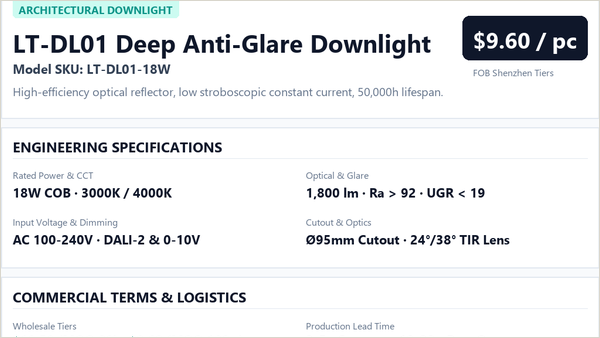
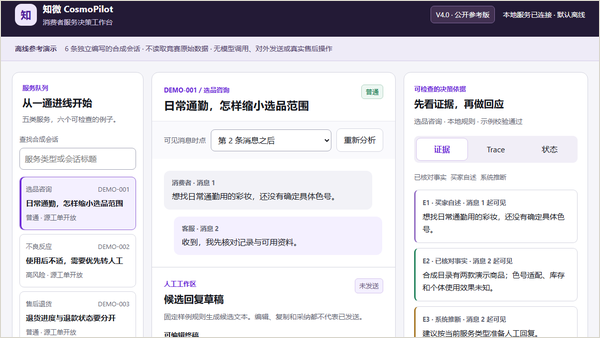
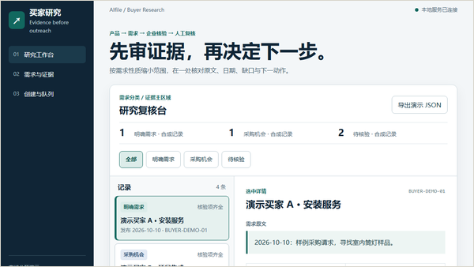
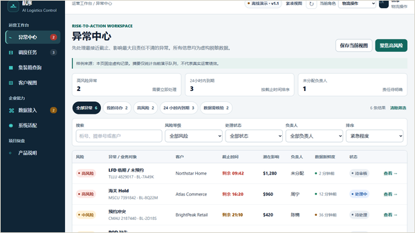

<picture>
  <source media="(prefers-color-scheme: dark)" srcset="assets/header-dark.svg" />
  <source media="(prefers-color-scheme: light)" srcset="assets/header-light.svg" />
  
</picture>

**我构建知道何时停止、何时请人接手的 AI Agent。**

把证据检索、对话状态和人工复核放进桌面与 Web 工作台。

12 个公开仓库 · 217 项自动化测试 · 4 个在线演示

## 核心项目

<table>
<tbody>
<tr>
<td width="50%" valign="top">
 
<strong>外贸询盘工作台</strong> 
用商品目录核对买家需求，生成可复核的报价。 
<a href="https://github.com/Daniel-24-life/trade-desk-copilot#demo">演示 GIF</a> · <a href="https://github.com/Daniel-24-life/trade-desk-copilot">仓库</a>
</td>
<td width="50%" valign="top">
 
<strong>CosmoPilot 消费者服务台</strong> 
查看客服会话在指定时点的证据，保留人工草稿修改。 
<a href="https://github.com/Daniel-24-life/cosmopilot-v4#demo">演示 GIF</a> · <a href="https://github.com/Daniel-24-life/cosmopilot-v4">仓库</a>
</td>
</tr>
<tr>
<td width="50%" valign="top">
 
<strong>买家研究工作台</strong> 
梳理买家需求，将证据缺口放入审核队列。 
<a href="https://github.com/Daniel-24-life/buyer-research-agent#demo">演示 GIF</a> · <a href="https://github.com/Daniel-24-life/buyer-research-agent">仓库</a>
</td>
<td width="50%" valign="top">
 
<strong>航序物流协同工作台</strong> 
将运输异常派成任务，跟进处理状态。 
<a href="https://daniel-24-life.github.io/logistics-workbench/">在线演示</a> · <a href="https://github.com/Daniel-24-life/logistics-workbench">仓库</a>
</td>
</tr>
</tbody>
</table>

## 我如何构建 Agent

- **证据先于答案。** 列出判断依据和缺失信息。
- **给自动化设边界。** 把不清楚或影响较大的情况交给人复核。
- **默认可复现。** 提供样例、运行命令和验证范围。

[完整作品目录](https://github.com/Daniel-24-life/portfolio/blob/main/README.zh.md) · [English](README.md)
